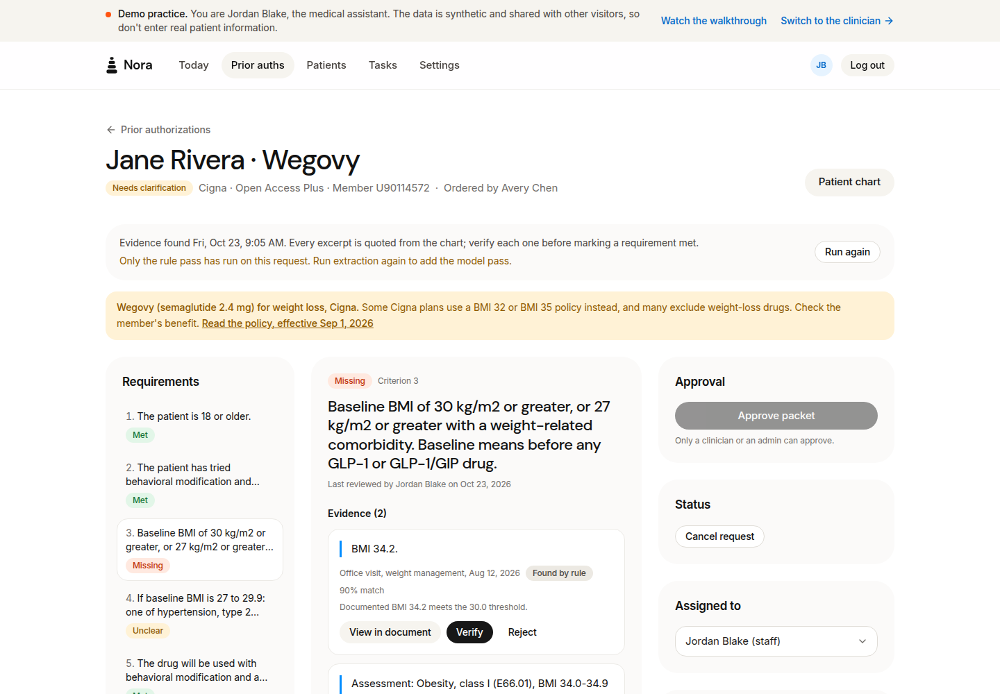

# Nora

A prior-authorization workspace for medical-office staff that checks a patient's chart against the payer's published criteria, quotes the chart text that documents each one, and sends what is missing to the clinician.



**Live demo:** [mai-omega.vercel.app/demo](https://mai-omega.vercel.app/demo) opens a synthetic practice with no sign-up. Add `?tour=1` for a guided walkthrough.

## Features

- **Quotes, never claims:** every requirement is answered with the chart's own sentence, its document and date. Staff verify each quote, a clinician approves the packet, and Nora never marks a requirement met by itself.
- **Real payer criteria:** the initial-authorization criteria for Wegovy, Zepbound and Saxenda from UnitedHealthcare, Aetna, Cigna and the BCBS Federal Employee Program, each linked to its published policy and effective date. Criteria are versioned, so a request keeps the criteria it was opened under.
- **Gaps become tasks:** a requirement the chart does not support is marked missing and turned into a documentation task for the ordering clinician.
- **Measured, not assumed:** an evaluation, planned in writing before it ran, found that adding a language model made the evidence worse (it proposed text for unsupported requirements far more often), so Nora runs on rules. [The evaluation in two minutes](docs/EVALUATION.md).
- **Approval that means something:** a clinician's approval pins the exact evidence they saw. Any later edit voids it. The approved packet renders as a PDF and is tracked to the payer's decision.
- **Workflow integrity:** a request's status changes only through one service that records an event and an actor; every read or write of patient data is logged; the browser authenticates with an httpOnly cookie and a CSRF token.
- **Tested end to end:** RSpec on SQLite and PostgreSQL, Jest, and Cypress driving the real console against the real API, all in CI.

## Tech Stack

| Technology | Purpose |
| :--- | :--- |
| **Ruby 4.0, Rails 8.1 (API mode)** | Backend, workflow services, rule-based evidence extraction |
| **SQLite / PostgreSQL** | SQLite for zero-setup development; PostgreSQL via `DATABASE_URL`, tested in CI |
| **Active Job, solid_queue** | Evidence extraction in the background |
| **OpenAI via `Ai::Client`** | Optional model pass and payer-question help, behind one adapter (off by default) |
| **prawn, pdf-reader** | Approved packets as PDF; text from uploaded chart PDFs |
| **Next.js 16, React 19, TypeScript** | The staff console |
| **Tailwind CSS, shadcn/ui, SWR, Zod** | Styling, components, data fetching, response validation |
| **RSpec, Jest, Cypress** | Backend, frontend and end-to-end tests |
| **medspaCy** | Clinical NLP baseline in the evaluation |
| **Render, Vercel** | API and console hosting for the demo |

## Getting Started

### Prerequisites

Ruby 4.0.x, Node.js 22.13 or later, and pnpm 12 (pnpm 12 refuses to run on older Node). Docker only to run the PostgreSQL test suite locally.

```bash
ruby --version   # 4.0.x
node --version   # v22.13 or later
pnpm --version   # 12.x
```

### Installation

```bash
git clone https://github.com/saintparish4/nora.git
cd nora
make setup                                   # install, create, migrate, seed
cp api/.env.example api/.env                 # set SECRET_KEY_BASE: openssl rand -hex 64
cp base/.env.local.example base/.env.local
```

## Usage

```bash
make dev
```

- Console: http://localhost:3005
- API: http://localhost:3006

The API logs each request with its timing. `make dev SQL_LOG=1` adds every SQL query and the line of code that ran it.

http://localhost:3005/demo signs you in to the synthetic demo practice as the medical assistant (`/demo?as=clinician` for the clinician, who can approve), and `/demo?tour=1` plays the walkthrough. Or sign in with a seeded account, password `password123`:

| Email | Role |
| :--- | :--- |
| `demo@nora.com` | Admin |
| `clinician@nora.com` | Clinician (can approve) |
| `ma@nora.com` | Medical assistant |

The demo practice has five synthetic patients on four payers and four requests at different stages: decided by the payer, waiting for the clinician, blocked on missing documentation, and just read. The fifth patient has no request, so there is one to start. Every name and note is invented. `cd api && bin/rails demo:reset` puts it back the way the seeds left it.

Run the evaluation (no API key needed for the rule pass):

```bash
cd api
bin/rails eval:evidence:selfcheck   # proves the harness first
bin/rails eval:evidence ROUND=rules
```

## Configuration

Copy the templates and fill in what you need: `api/.env.example` and `base/.env.local.example` list every variable.

- `SECRET_KEY_BASE` (API): required. Signs the session cookie and tokens.
- `NEXT_PUBLIC_API_URL` (console): required. The API's URL, `http://localhost:3006` locally.
- `OPENAI_API_KEY` (API): optional. Enables the model pass and "Help with a payer question". Without it, extraction runs the rules and says so on screen.
- `DEMO_PRACTICE` (API): `true` seeds the demo practice in production and enables `/demo`. Always on outside production; the deployed API rebuilds the practice on every boot.
- `AI_PHI_BAA_CONFIRMED` (API): production refuses to send a real practice's chart text to a model unless this is `true`. The synthetic demo practice is exempt.
- `DATABASE_URL` (API): a `postgres://` URL switches from SQLite to PostgreSQL.

Nora uses synthetic data only. It is a portfolio project, not a product in use with patients.

## Contributing

```bash
make test        # RSpec + Jest
make test-e2e    # Cypress against the real API and console, on ports 3105/3106
make lint        # RuboCop + ESLint
cd api && bundle exec brakeman --no-pager   # security scan, as CI runs it
```

Commits follow [Conventional Commits](https://www.conventionalcommits.org/). CI ([.github/workflows/test.yml](.github/workflows/test.yml)) runs on every push and pull request to `main`: RuboCop, Brakeman and RSpec on SQLite and on PostgreSQL, ESLint, the production build and Jest, and the Cypress suite. [docs/ARCHITECTURE.md](docs/ARCHITECTURE.md) describes the services, routes and the safety rules the code enforces.

## License

Distributed under the [MIT License](LICENSE). See `LICENSE` for more information.
